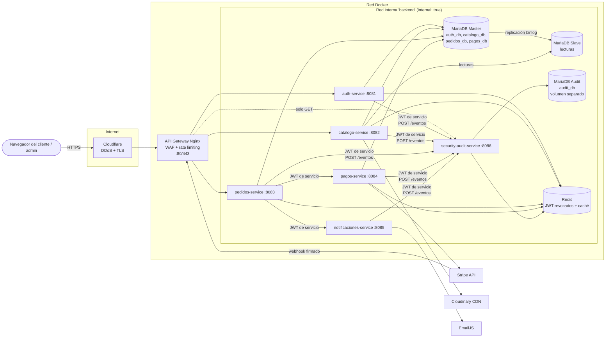
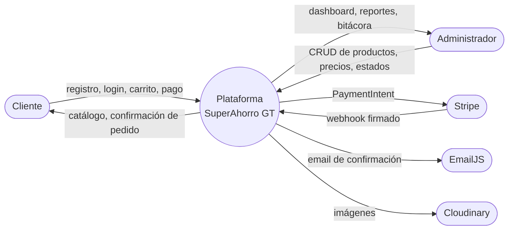
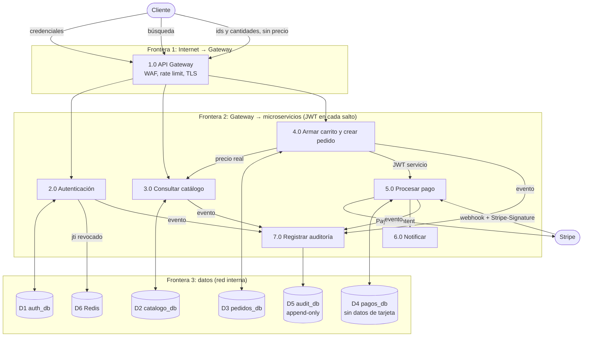

# Proyecto Final No. 2 — Avance Semana 1

**Negocio elegido:** Opción **B — Supermercado / Abarrotería en línea** ("SuperAhorro GT")
**Curso:** Auditoría y Seguridad de Sistemas — Décimo ciclo

## 1. Justificación del tipo de negocio

El sistema del Proyecto 1 era una tienda general de electrónica y artículos varios. Para el Proyecto 2 se eligió un **supermercado en línea**, que cumple con ser un tipo de negocio distinto y además plantea riesgos de seguridad propios:

- **Mucho tráfico de catálogo:** miles de productos con precios que cambian seguido (ofertas semanales), lo que lo hace un blanco atractivo para el *scraping* de precios por parte de la competencia.
- **Compras frecuentes y repetidas:** los clientes guardan dirección de entrega y teléfono (datos personales), y las cuentas tienen valor para atacantes que usan *credential stuffing*.
- **Productos perecederos y stock crítico:** manipular el stock o los precios tiene impacto directo en las pérdidas.
- **Entrega a domicilio:** se manejan direcciones físicas de clientes, que son información sensible.

## 2. Arquitectura distribuida

**Estado en la semana 1:** ya están implementados el API Gateway, `auth-service`, `security-audit-service`, MariaDB Master, MariaDB Audit y Redis. Los demás servicios se agregan en las semanas 2 y 3.

### Principio Zero Trust aplicado

| Regla | Implementación |
|---|---|
| Nadie confía en la red interna | Cada servicio valida el JWT en **cada** petición (`Guard::user()` / `Guard::service()` en `services/shared/Guard.php`) |
| Tokens distintos para usuarios y servicios | `JWT_SECRET` firma los tokens de usuario; `JWT_SERVICE_SECRET` firma los de servicio (60 s de vida) |
| Revocación inmediata | Cada servicio consulta la lista negra de Redis (`TokenBlacklist::isRevoked`); si Redis no responde, el token se rechaza (fail-closed) |
| Mínimo privilegio en BD | Cada servicio tiene su propio usuario de BD con permisos solo sobre su base; el de auditoría solo tiene `SELECT, INSERT` |
| Superficie expuesta mínima | Solo el gateway publica un puerto; la red `backend` es `internal: true` |

## 3. Diagrama de flujo de datos (DFD) con fronteras de confianza

### DFD nivel 0 (contexto)

### DFD nivel 1 (ciclo de compra)

## 4. Modelado de amenazas STRIDE — Supermercado en línea

| STRIDE | Flujo afectado | Ataque concreto en el supermercado | Contramedida | Estado |
|---|---|---|---|---|
| **S** Spoofing | Login de cliente (2.0) | *Credential stuffing* con listas filtradas para usar cuentas con direcciones y métodos de pago guardados | bcrypt cost 12; bloqueo de 15 min tras 5 intentos (`AuthService::login`); `limit_req zone=login 5r/m` en Nginx; tiempo de respuesta constante con `DUMMY_HASH`; evento `LOGIN_CLIENTE_FALLIDO` con IP | **Implementado** |
| **S** Spoofing | Servicio → servicio | Un contenedor comprometido se hace pasar por `pedidos-service` para registrar eventos falsos | JWT de servicio firmado con un secreto distinto; `security-audit-service` toma el nombre del servicio del token y no del body | **Implementado** |
| **T** Tampering | Carrito → pedido (4.0) | Cambiar en el inspector el precio de "Aceite 1L" de Q32.00 a Q0.01 en el POST `/api/pedidos` | El cliente solo envía `producto_id` y `cantidad`; el precio se consulta en `catalogo-service` del lado del servidor | Semana 2 |
| **T** Tampering | Promociones y cupones | Aplicar varias veces un cupón de descuento o cambiar el porcentaje | Validación del cupón en el servidor, con uso único por cliente | Semana 2 |
| **T** Tampering | Bitácora (7.0) | Un atacante con acceso a la BD borra sus rastros | Usuario de BD solo con `SELECT, INSERT`; triggers que bloquean `UPDATE`/`DELETE`; endpoints `PUT/PATCH/DELETE` devuelven 405; el gateway solo permite `GET` hacia fuera | **Implementado** |
| **R** Repudiation | Confirmación de pago (5.0) | El cliente dice que nunca pagó o que no recibió el pedido de víveres | `PAGO_CONFIRMADO` con `payment_intent_id` de Stripe; `PEDIDO_ESTADO_CAMBIADO` con estado anterior y nuevo; email de confirmación | Semana 3 |
| **R** Repudiation | Panel admin | Un empleado niega haber cambiado un precio | `PRECIO_MODIFICADO` con `dato_anterior` y `dato_nuevo`; `ACCESO_ADMIN_PANEL` | Parcial (acceso admin implementado) |
| **I** Info Disclosure | Mis pedidos (4.0) | `GET /api/pedidos?id=124` muestra la dirección y el teléfono de otro cliente | `WHERE id_cliente = `; UUID públicos en lugar de IDs secuenciales | Semana 2 |
| **I** Info Disclosure | Pago (5.0) | Robo de tarjetas guardadas en la BD | Nunca se reciben ni se guardan tarjetas: Stripe Checkout; `pagos` solo guarda `payment_intent_id` | Semana 3 |
| **I** Info Disclosure | Errores | Mensajes con rutas o SQL exponen la estructura interna | `display_errors=Off`; respuestas genéricas `500`; `ServerTokens Prod`; `server_tokens off` | **Implementado** |
| **D** DoS | Catálogo (3.0) | La competencia hace *scraping* masivo de precios cada hora y satura la BD | Rate limit por IP (`zone=catalogo 10r/s`); caché en Redis; lecturas en MariaDB Slave; Cloudflare | Gateway listo, caché en semana 2 |
| **D** DoS | Infraestructura | Un DDoS consume la memoria del servidor | `mem_limit` y `cpu_shares` por contenedor; `limit_conn` por IP | **Implementado** |
| **E** Elevation of Privilege | Panel admin | El cliente edita su JWT y cambia `"rol":"cliente"` por `"admin"` | Firma HMAC-SHA256 verificada en cada servicio; se rechaza `alg=none`; el rol solo lo asigna el servidor (el registro siempre crea `cliente`); intento registrado como `ACCESO_ADMIN_PANEL` con resultado `FALLO` | **Implementado** (`scripts/test-jwt.php`) |
| **E** Elevation of Privilege | Contenedores | Escape desde un servicio PHP comprometido | `USER www-data`; `no-new-privileges`; sin puertos de BD ni Redis expuestos | **Implementado** |

## 5. Estructura de la base de auditoría (`audit_db.security_audit_logs`)

Implementada en `db/audit/init/01_audit_db.sql` siguiendo la sección 6.1 del enunciado: `id`, `timestamp DATETIME(3)`, `usuario_id`, `usuario_email`, `rol`, `accion`, `servicio`, `pedido_id`, `pago_id`, `dato_anterior JSON`, `dato_nuevo JSON`, `ip_origen`, `user_agent` y `resultado`.

Controles de inmutabilidad:

1. Contenedor `mariadb-audit` con volumen `audit_data` **separado** de las BD de negocio.
2. El usuario `audit_writer` solo tiene `GRANT SELECT, INSERT`.
3. Triggers `trg_audit_no_update` y `trg_audit_no_delete`.
4. La API responde 405 a `PUT`, `PATCH` y `DELETE`, y el gateway solo deja pasar `GET` hacia `/api/auditoria/`.

Eventos que ya se generan en la semana 1:

| Evento | Servicio | Cuándo |
|---|---|---|
| `REGISTRO_CLIENTE` | auth-service | Registro exitoso o email duplicado |
| `LOGIN_CLIENTE_EXITOSO` | auth-service | Login correcto |
| `LOGIN_CLIENTE_FALLIDO` | auth-service | Usuario inexistente, contraseña incorrecta, cuenta bloqueada o inactiva |
| `TOKEN_REVOCADO` | auth-service | Logout (el `jti` pasa a la lista negra de Redis) |
| `ACCESO_ADMIN_PANEL` | auth-service | Admin entra al panel (`EXITO`) o un cliente lo intenta (`FALLO`) |

## 6. Plan de las siguientes semanas

| Semana | Técnico | Seguridad |
|---|---|---|
| 2 (17 oct) | `catalogo-service` con Cloudinary y 20+ productos de supermercado; `pedidos-service`; replicación Master-Slave | A01 (pedidos por cliente), A03 (validación del carrito), eventos `PEDIDO_CREADO`, `PRECIO_MODIFICADO`, `PRODUCTO_AGOTADO`, `PEDIDO_ESTADO_CAMBIADO` |
| 3 (24 oct) | `pagos-service` con Stripe; `notificaciones-service` con EmailJS; OpenWeatherMap; caché Redis | Webhook con `Stripe-Signature`, eventos de pago, primera ejecución de OWASP ZAP, evidencia de `docker ps` |
| 4 (31 oct) | Panel admin completo con Chart.js; hosting; HTTPS | BCP/DRP, presupuesto ALE/ROSI, 30+ registros de auditoría, PDF final |
