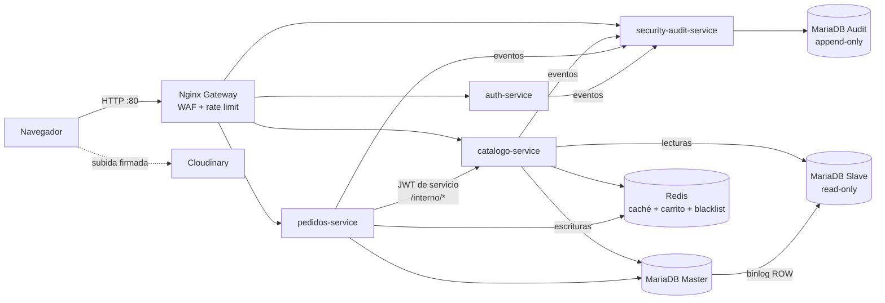

# Avance semana 2 — Catálogo, pedidos, Master-Slave y OWASP A01/A02/A03

**Entrega:** 17 de octubre de 2026
**Evidencia automatizada:** `scripts/prueba-semana2.ps1` (52 verificaciones) y `scripts/prueba-semana1.ps1` (23, sin regresiones).

## 1. Qué se agregó

| Componente | Descripción |
|---|---|
| `catalogo-service` (8082) | Categorías y productos en GTQ, búsqueda y filtros, caché en Redis, panel admin de productos y subida firmada de imágenes a Cloudinary. |
| `pedidos-service` (8083) | Carrito en Redis, checkout con datos de entrega, historial del cliente, gestión de estados por el admin y exportación CSV de clientes. |
| `mariadb-slave` | Réplica de solo lectura del Master (`read-only`, `server-id=2`). Las lecturas del catálogo van al Slave; si cae, se lee del Master automáticamente. |
| Gateway | Rutas `/api/catalogo/` y `/api/pedidos/`, zona de rate limiting propia para el catálogo y bloqueo de cualquier ruta `/interno`. |
| Frontend | Tienda (catálogo, carrito, checkout, mis pedidos) y panel admin (productos, pedidos, bitácora). Construido sin `innerHTML`. |



## 2. Replicación Master-Slave

- Master: `log-bin`, `binlog-format=ROW`, `server-id=1`. Usuario de replicación creado por la imagen oficial con `MARIADB_REPLICATION_USER/PASSWORD` (credenciales en `.env`).
- Slave: `MARIADB_MASTER_HOST=mariadb-master`, `read-only`, `server-id=2`. El healthcheck verifica que la replicación esté corriendo.
- Enrutamiento de lecturas: `Db::read()` en `services/shared/Db.php` usa el Slave y, si la conexión falla, vuelve al Master (`fuente_bd = "master (failover)"`). El catálogo devuelve `fuente_bd` en cada respuesta para evidenciarlo.
- Pruebas: producto creado en el Master aparece en el Slave; `Slave_IO_Running` y `Slave_SQL_Running` en `Yes`; un `UPDATE` en el Slave es rechazado; con el Slave detenido el catálogo sigue respondiendo.

Comandos para la captura de evidencia:

```powershell
'SHOW SLAVE STATUS\G' | docker compose exec -T mariadb-slave sh -c 'mariadb -uroot -p$MARIADB_ROOT_PASSWORD' | Select-String 'Running:|Behind'
Invoke-RestMethod 'http://localhost/api/catalogo/productos?por_pagina=1' | Select-Object total, fuente_bd, cache
```

## 3. OWASP Top 10 — controles implementados

### A01 — Broken Access Control

| Riesgo en el supermercado | Control | Dónde |
|---|---|---|
| Un cliente ve los pedidos de otro (IDOR) | El filtro por cliente sale del `sub` del JWT verificado, nunca de un parámetro. Un pedido ajeno devuelve **404** (no 403) para no revelar que existe. | `PedidosService::misPedidos`, `buscarPedido` |
| Enumerar pedidos con IDs secuenciales | La API solo expone un UUID v4 aleatorio; `id` e `id_cliente` se eliminan de la respuesta. | `PedidosService::uuid4`, `buscarPedido` |
| Cliente cambia precios o estados | Todas las rutas `/admin/*` exigen `Guard::user(['admin'])`; el rol viene firmado en el JWT. | `CatalogoService::admin*`, `PedidosService::admin*` |
| Llamar endpoints internos (descontar/reponer stock) | El gateway responde 404 a `/api/*/interno`; además el servicio exige un JWT de **servicio** emitido por `pedidos-service` (Zero Trust aunque la petición venga de dentro de la red). | `gateway/nginx.conf`, `Guard::service(['pedidos-service'])` |
| Saltarse transiciones de estado | Máquina de estados en el servidor (`pendiente → preparando → en_camino → entregado`); transiciones inválidas devuelven 409. | `PedidosService::TRANSICIONES` |

### A02 — Cryptographic Failures

| Riesgo | Control |
|---|---|
| Secretos en el repositorio | Contraseñas de BD, replicación, Redis, JWT y Cloudinary solo en `.env` (en `.gitignore`), generado con `random_bytes` por `scripts/generar-env.php`. |
| API secret de Cloudinary expuesto en el navegador | Subida **firmada**: el servidor calcula `sha1(folder=…&timestamp=…+secret)`; el navegador solo recibe la firma, nunca el secret. |
| Tokens falsificados | JWT HS256 con secreto ≥ 32 caracteres, `alg=none` rechazado, `exp`/`iss` validados; secretos distintos para tokens de usuario y de servicio. |
| Contraseñas | bcrypt costo 12 (semana 1). |
| Datos de tarjeta | El esquema `pedidos_db` no tiene columnas de tarjeta; el pago con Stripe se integra en la semana 3 sin almacenar PAN/CVV. |

### A03 — Injection

| Vector | Control | Dónde |
|---|---|---|
| SQL injection en búsqueda, filtros y formularios | 100 % consultas preparadas con `PDO::ATTR_EMULATE_PREPARES = false`; los nombres de columna en los `UPDATE` dinámicos salen de una lista blanca, nunca del usuario. | `services/shared/Db.php`, `CatalogoService::validarProducto` |
| Comodines en `LIKE` (`%`, `_`) para volcar el catálogo | Se escapan con `addcslashes` antes de la consulta. | `CatalogoService::listarProductos` |
| XSS almacenado en notas/direcciones | `strip_tags` + validación de longitud en el servidor; el frontend crea nodos con `textContent` (sin `innerHTML`); CSP `script-src 'self'`. | `PedidosService::texto`, `gateway/html/js/app.js` (`el()`) |
| Inyección de fórmulas en el CSV exportado | Celdas que empiezan con `= + - @` se prefijan con `'`. | `PedidosService::celdaCsvSegura` |
| URLs de imagen maliciosas | Solo se aceptan URLs `https://res.cloudinary.com/...`; CSP `img-src` limitada a Cloudinary. | `CatalogoService::validarProducto` |
| Ataques en la URL | WAF básico en Nginx (SQLi/XSS/path traversal en query string, user-agents de escáneres). | `gateway/nginx.conf` |

### Manipulación de precios (fraude)

El cliente nunca envía precios ni productos al confirmar: el pedido se arma con el carrito guardado en Redis y los precios se consultan a `catalogo-service` en el servidor. Si el cuerpo trae `precio`, `total`, `items`, etc., la petición se rechaza con 400 y se registra `PEDIDO_CREADO` con resultado **FRAUDE**, guardando los valores recibidos como evidencia.

El stock se descuenta dentro de una transacción con `SELECT … FOR UPDATE` (evita vender la última unidad dos veces). Si el pedido no se puede confirmar, se repone el stock como compensación.

## 4. Eventos de auditoría nuevos

| Evento | Cuándo se emite | Servicio |
|---|---|---|
| `PEDIDO_CREADO` (EXITO) | Pedido confirmado; guarda UUID, total e items con precio unitario. | pedidos |
| `PEDIDO_CREADO` (FRAUDE) | Cliente envió precios/items en el checkout. | pedidos |
| `PEDIDO_ESTADO_CAMBIADO` | Admin cambia el estado; guarda estado anterior y nuevo. | pedidos |
| `EXPORTACION_CLIENTES` | Admin descarga el CSV; guarda cantidad de registros y columnas. | pedidos |
| `PRECIO_MODIFICADO` | Admin crea un producto o cambia su precio; guarda precio anterior y nuevo. | catalogo |
| `PRODUCTO_AGOTADO` | El stock llega a 0 por una venta (con `pedido_id`) o por edición del admin. | catalogo |

Con la semana 1 la bitácora ya cubre **10 de los 14** tipos de evento (meta de la semana: 8+). Los 4 restantes (`PAGO_INICIADO`, `PAGO_CONFIRMADO`, `PAGO_FALLIDO`, `WEBHOOK_STRIPE_RECIBIDO`) llegan con `pagos-service` en la semana 3.

## 5. Cloudinary (API externa 1)

1. Crear una cuenta gratuita en <https://cloudinary.com> y copiar *Cloud name*, *API Key* y *API Secret* del dashboard.
2. Pegarlos en `.env` (`CLOUDINARY_CLOUD_NAME`, `CLOUDINARY_API_KEY`, `CLOUDINARY_API_SECRET`) y ejecutar `docker compose up -d catalogo-service`.
3. En el panel admin → Productos → botón **Imagen** de cualquier producto. La imagen se sube directo a Cloudinary y se guarda la URL optimizada (`c_fill,w_400,h_400,q_auto,f_auto`).

Sin credenciales, el endpoint de firma responde 503 y la tienda muestra el ícono de la categoría; el resto de la plataforma funciona igual.
